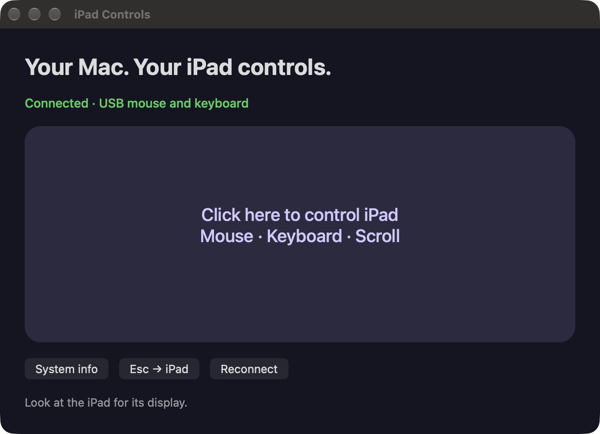

# iPad Controls

Use your Mac's mouse and keyboard to control **an iPad that has already reached its Omarchy Linux desktop**. Look at the iPad for the display; the Mac app supplies pointer movement, clicks, scrolling and keyboard input over authenticated SSH.

This is useful after bringing up Omarchy on an iPad when native touch or a directly connected keyboard/mouse is unavailable. It connects to the running system; booting and installing Linux are handled by your existing setup.

## Features

- Native macOS app with a click-to-capture control pad.
- Relative mouse movement, left/right/middle click, dragging and scrolling.
- Physical keyboard input; Command maps to Linux Super.
- Escape releases control back to the Mac; the **Esc → iPad** button sends Escape to Linux.
- Input releases when the app loses focus. Heartbeats and reconnect attempts handle connection loss.
- **System info** opens Omarchy's About window on the iPad when the tested adapter is available.
- Temporary Linux input devices disappear when the SSH session ends.



*The app connected to a running iPad desktop over USB. Connection details stay local.*

## Requirements and scope

- macOS 13 or later; the downloadable build is for Apple silicon. Build from source on Intel for a native Intel app (untested).
- A running Linux desktop on the iPad, reachable by SSH. The tested setup uses a USB network link.
- Python 3 on the iPad, `/dev/uinput` available, and the SSH user permitted to write it and read input devices as appropriate. Use your distribution's input/udev setup; do not make uinput world-writable.
- Key-based SSH already working, with the server host key independently verified and pinned in a local known-hosts file.

Hardware evidence: mouse X/Y events, keyboard press/release, release-all, heartbeat and disconnect cleanup passed on an iPad Air 2 (J81) running an Omarchy for iPad community desktop with Labwc. Linux classified both virtual devices as mouse/keyboard. Other iPads, desktops, SSH layouts and Intel Macs are unqualified. The bridge assumes a 64-bit Linux userspace and a US-style physical key map. This does not provide screen mirroring, clipboard transfer, iOS control or a boot/recovery path.

## Build or download

Download the credential-free app from [Releases](https://github.com/micro23/ipad-controls/releases), or install Apple's command-line developer tools and build locally:

```sh
python3 scripts/build.py
open 'dist/iPad Controls.app'
```

The public app is ad-hoc signed, not Apple notarized. macOS may require your normal approval to open it; building from reviewed source is also supported.

## Configure your connection

Create `~/.config/ipad-controls/connection.json` using [connection.example.json](connection.example.json). Replace the absolute key and known-hosts paths with your own. The example address/port are the tested USB-network defaults, not discovery of your device.

Use a dedicated key already authorized for your Linux account. Keys that require an interactive passphrase need to be available through your local SSH agent; this app uses batch SSH. Private keys stay in your chosen local file and are never bundled into public builds.

First verify the same connection in Terminal, using your own paths and values:

```sh
ssh -o StrictHostKeyChecking=yes -o UserKnownHostsFile=/path/to/verified_known_hosts \
  -i /path/to/dedicated_key -p 2222 tablet@10.71.0.1
```

Verify the host fingerprint against a trusted console or prior trusted record. A network key scan alone does not authenticate the server. Keep the local configuration and private key readable only by you. Do not commit those files.

Open the app after configuring it, then click the pad. Keep your eyes on the iPad. Press Escape to return control to the Mac. The app keeps your cursor captured until release or loss of focus. The first click captures control without clicking the iPad.

The optional System info action expects `/usr/local/bin/omarchy-launch-about`, desktop UID 1000, `/run/user/1000`, `wayland-0` and the user session bus. These match the tested Omarchy setup; adapt `src/bridge.py` for a different session.

## Troubleshooting

- **Setup needed:** check that the JSON exists at the exact path above, has all five fields, and uses absolute paths. Paths with backslashes, quotes or newlines are rejected.
- **Disconnected/retrying:** confirm the cable/network and the exact SSH command in Terminal. Check pinned host key, key authorization, Python availability and uinput permissions. The app does not change network settings or install drivers.
- **Pointer/keyboard unavailable:** verify your compositor sees the virtual mouse and keyboard; uinput access alone does not prove compositor integration.
- **System info does nothing:** verify the adapter and Wayland session paths listed above.
- **Different keyboard layout:** this release forwards physical keycodes with a US-style mapping; remap on Linux or adjust the source.

## Related projects

- [iPad Air 2 Omarchy](https://github.com/micro23/ipadair2-omarchy): device bring-up, native installation and qualification.
- [Orchard hardware fork](https://github.com/micro23/hardware): hardware integration work; this app is an optional host tool.

## Privacy and implementation

The app starts the bundled Python bridge through the user's authenticated SSH connection. The bridge creates two session-scoped uinput devices and accepts a bounded input command set over stdin. It creates no network listener on the iPad. The optional About action runs a fixed command. SSH enforces strict host-key verification. No analytics, cloud service or account is required.

Public source and releases contain no owner credentials, host keys, screenshots of personal device state, firmware, calibration, logs or personal filesystem paths. Your working local app can retain its private connection separately. See [release notes](docs/RELEASE-v1.0.0.md).

MIT licensed; see [LICENSE](LICENSE).
